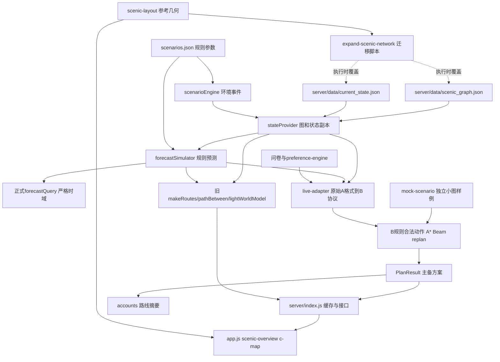

# 景策万象 B 负责人数据资产审计报告

本报告审计当前本地代码和数据，用于B的候选动作、合法性、规则推进、A*、Beam Search、PlanResult和重规划开发。没有实现新算法、修复业务代码或补造真实景区资料。

## 1. 审计范围

- 工作目录：`D:\jingcewanxiang-2`（命令工作目录显式指定）。
- 仓库origin：`https://github.com/XYL100617/jingce-wanxiang.git`（fetch/push配置相同）。
- 分支：`main`；HEAD：`cc93dd3c9d0239d6b6385f71b6a3978124031302`。
- 审计日期：2026-10-26（Asia/Shanghai）。模拟数据日期为2026-10-20，二者不能混同。
- 初始Git：`On branch main`、`Your branch is up to date with 'origin/main'`、`nothing to commit, working tree clean`；`git status -sb`为`## main...origin/main`。
- “up to date”只对应本地远程跟踪引用；本轮未fetch/pull或联网核验GitHub是否又有提交，远程实时最新状态UNKNOWN。
- 初始59个非.git文件中有58个已跟踪文件，另有已忽略的`server/data/audit.local.jsonl`，包含3条历史本地日志。Git clean不代表不存在忽略文件；其内容未复制进报告。
- 扫描覆盖server/data、examples、state、planner、docs/contracts及examples、public、scripts、test、server/tests、README、index和package。55个代码/JSON/文档/页面/样式文件用于字段与引用追踪；PNG另作视觉检查。全局业务关键词扫描56文本文件、53命中文件、5545命中行、9618匹配。
- .git内部存储不属于业务数据资产；未发现AGENTS.md。没有下载外部资料或按外部网站补造事实。

最初受限环境中普通git status出现“must be run in a work tree”等环境错误；经系统授权在真实项目目录运行相同只读命令后确认工作区干净，不能把该环境错误记录成仓库损坏。

## 2. 当前数据架构概览

`stateProvider`读取唯一原始图和初始状态，返回副本并在内存中维护版本。环境事件由scenarioEngine应用，forecastSimulator按固定规则生成全园预测。B规划入口通过live-adapter把原始A数据转为分离业务对象的B协议；mock分支则完全使用独立小图。前端共享规范ID和视觉布局，但仍有旧路线模板、展示样例及未启用的Canvas图。



当前模型“预测”是规则生成，未发现神经网络训练权重。B rules只推进游客副本，不自动改变全园真实客流。管理事件和进度在集成入口写入权威内存状态；不能把规则转移输出直接当真实游客轨迹。

## 3. 已发现的数据资产

目录详见[data_asset_catalog.md](data_asset_catalog.md)，共38组资产，覆盖静态图/初值、环境场景、预测和查询、B适配/规则/输出、问卷偏好、硬编码知识和DNA、账号反馈/日志、共享/装饰/旧Canvas几何、OSM参考底图、页面显示语义、全部JSON样例、Schema、已有测试和迁移脚本。

未发现独立来源登记、采集原始文件、现场核验记录、许可证清单、真实GPS轨迹、实际入口表、完整运营演出日历、结构化检索知识库、训练episode或固定训练/验证/测试切分。部分注释声称源于手绘图或公开导览图，但没有原图文件/URL/许可凭据；因此记录为REFERENCE_ONLY或UNKNOWN。

## 4. ID体系审计

| 命名空间 | 当前证据 | 结论 |
| --- | --- | --- |
| node_id | 45个唯一非空节点；4园门 | 图节点，不能以名称作为外键 |
| edge_id | edge_001–edge_068，端点均存在 | 与状态、预测、共享layout.edges同一68键集合 |
| poi_id | node内嵌41个，全部同node_id | 有关联但没有独立实体/实际入口表；B适配后仅38普通POI |
| event_id | raw show-1和market-peak；B只派生show-1 | 前者演出、后者运营预测事件；均有合法node_id |
| facility_id | raw无独立设施表；适配rest/chaguan两项 | 都有合法node_id；前端6个f_*不是这2个设施的已证实别名 |
| exit_id | exit_gate/southgate/westgate/eastgate四个派生ID | 均映射合法园门node；缺独立出口开放生命周期 |
| visitor_id | visitor_001 | 单份共享演示游客；与账号UUID不同 |
| mock ID | 6节点/9边等独立小图 | node_garden、poi_history等不是景区节点别名 |
| 视觉ID | 8参考地标、16secondaryPaths、6视觉设施、35旧Canvas点 | 保留视觉命名空间，不能计入业务外键错误或自动变成可达道路 |

三处片区入口参考地标water_margin_entrance/xianxia_entrance/jianghu_stage_entrance没有业务node_id绑定。market/juxianzhuang/summit等兼任AREA_ENTRANCE代理，不能凭区域名把它们与上述地标判为同一物理入口。脚本明示northgate/北大门→westgate/西大门；这是有代码证据的旧ID迁移。旧Canvas的north=中门又是另一视觉命名空间，不能等同退役northgate。

[id_mapping.csv](id_mapping.csv)包含291行记录。规范名取当前主图而非宣称官方名称；不确定绑定标REVIEW_REQUIRED；所有graph_version=UNKNOWN。referenced_in记录文本出现位置，并不表示测试/负面样例中的出现就是合法外键。不得以同名自动合并。

## 5. 字段和数据字典审计

[data_dictionary.md](data_dictionary.md)覆盖node、edge/road、poi、event、facility、visitor、Action/Route/ItineraryItem、ScenicState、EnvironmentForecast、PlanResult、UserEvent、scenario、画像、账号与视觉实体。字段类型、必填依据、单位、时间、ID关系和B用途分列。

原始A数据和B协议的差异是实际存在的双层结构：type→node_type、open→is_open、queue_min→current_queue_min、direction→bidirectional、preference→preference_weights；原始crowd_level为字符串，B为0–4数字。live-adapter是正常联通路径，不能直接把原始三个JSON当成B协议请求。

按当前Schema关键字做只读内存检查：raw graph缺5项；raw state有41个crowd_level类型差异；raw forecast有287个同类差异；初始适配state的空weights缺8项。适配graph/forecast、mock三对象和生成PlanResult在已检查结构中通过。public/c-demo-plan也能过结构检查，却有时间/距离语义错误，说明Schema不能替代业务验证。

Schema中若干关键状态字典、业务时窗只为可选，alternative_plans只声明array，缺少覆盖率、外键、权重和、时序及路径成本一致性约束。运行时没有加载完整Schema校验器，手写validateInputs还会放过负距离/负基础耗时/负队列/越界疲劳的内存探针。字段来源、量纲缺证时保留UNKNOWN；例如weather.rain不能擅自定为毫米或概率。

## 6. 图拓扑质量

| 统计项 | 本次实际结果 |
| --- | --- |
| 原始节点/道路/嵌入POI | 45 / 68 / 41 |
| 节点类型 | gate4、scenery8、culture21、show9、view1、service2 |
| B适配节点/道路/普通POI/演出/设施/出口 | 45 / 68 / 38 / 1 / 2 / 4 |
| raw运营事件 | 2（show-1、market-peak）；其中可参加演出1 |
| 重复node/edge/poi ID | 各0 |
| 重复无向道路/自环/非法端点 | 各0 |
| 孤立节点/初始不可达节点 | 各0 |
| 连通分量 | 1；全部45点可到4个园门 |
| 方向 | 68条均BIDIRECTIONAL |
| 参考道路长度/基础耗时范围 | 40–1115米 / 1–14.87分钟 |
| 当前POI队列/拥挤比例 | 0–25分钟 / 0.2–0.76 |
| 当前关闭道路/关闭POI | 0 / 0 |
| 桥边 | 12条；下表为其关闭后无出口的小分量 |

| 关闭的桥边 | 被隔离的小分量 | 出口条件 |
| --- | --- | --- |
| edge_046 | circus, tiger_hall | 小支路内无4个园门节点 |
| edge_047 | tiger_hall | 小支路内无4个园门节点 |
| edge_052 | puyi_wharf, retro_block | 小支路内无4个园门节点 |
| edge_053 | puyi_wharf | 小支路内无4个园门节点 |
| edge_058 | bailemen | 小支路内无4个园门节点 |
| edge_059 | shili_yangchang | 小支路内无4个园门节点 |
| edge_060 | kuaipolin | 小支路内无4个园门节点 |
| edge_061 | chaguan | 小支路内无4个园门节点 |
| edge_062 | zhu_family_fort | 小支路内无4个园门节点 |
| edge_063 | magic_square | 小支路内无4个园门节点 |
| edge_064 | shuihu_li | 小支路内无4个园门节点 |
| edge_065 | flower_camp | 小支路内无4个园门节点 |


此桥边统计按当前声明的双向拓扑逐边删除验证，不是对真实景区灾害风险的推断。初始图可以保留返程路径，动态封路不能保证任意既有位置仍有出口；禁止凭空增加道路。道路实际是否可走/单向/有障碍仍需证据。

## 7. 时间数据审计

1. 原始timestamp/start/latest及预测点主要为SPACE字符串；scenarioEngine和planner/time对无时区字符串按UTC处理。Schema只接受SPACE正则；部分接口接受ISO Z，正式查询会保留输入的arrival_time/enter_time形式。前端日内显示与toLocaleTimeString又使用显示端环境。业务本地时区与UTC的转换政策尚未在数据中标清，不能把10:18擅自说成北京时间。
2. 初始模拟时间2026-10-20 10:18:00；正式启动每12秒推进1模拟分钟，POST /api/replan也显式推进一次。真实日志at/createdAt使用ISO墙钟，不能混入同一时间轴。
3. show-1开始和最晚入场均11:20；mock event_show最晚11:05、开始11:10。当前规则arrival<=latest允许入场，二者都符合代码；运营真实口径UNKNOWN。raw演出无end/duration，适配默认+30分钟。
4. live普通POI开放默认09:00–22:00，不是已核验营业时间。rules检查到达、排队后完成、演出截止及返程；8个没有事件排期的show节点仍以普通POI处理。
5. 正常预测60分钟、步长10，41×7 POI点和68×7道路点；事件边界额外插点，序列当前均严格递增；环境事件区间[start,end)。B mock声明90分钟但只有0/10/20/40或0/40采样。
6. A严格查询拒绝越界，B会沿用首末点；UserEvent的旧时间不被拒绝；B重规划可改写整个预测序列。步行小数分钟在格式化时还会丢弃不足1秒部分，需与复放精度约定。
7. public示例备选第二站11:00早于第一站完成11:01，主方案演出到达11:49晚于11:20。它是地图样例而不是业务时间正确性基准。

## 8. 坐标审计

| 位置/字段 | 类别 | 可确认的变换/来源 | 审计结论 |
| --- | --- | --- | --- |
| scenic_graph.nodes.algorithm_x/y | 算法参考坐标 | 脚本源图x/25.6、y/5，保留2位 | REFERENCE_ONLY；不是米、经纬度或测绘坐标 |
| stateProvider旧graph.nodes.x/y | 算法坐标别名 | 从algorithm_x/y复制 | REFERENCE_ONLY；用于旧页面 |
| scenic-layout.nodes/edges、referenceLandmarks/secondaryPaths/facilities/waterBodies | 地图参考/渲染坐标 | 2560×500手绘源空间；45/68业务键对齐，其他视觉命名空间 | REFERENCE_ONLY；verified=true仅代码标志，核验记录UNKNOWN |
| SVG overviewPoint/detailPoint | 渲染投影 | overview对y做小幅视觉调整；detail=[x,70+2.12y] | 不直接修改运行中拓扑 |
| overviewCanvasNodes/RouteNodes/Edges | 旧Canvas建筑/前庭/路线锚点 | 2400×1600画布；局部世界坐标按1.8缩放加偏移 | REFERENCE_ONLY；前庭不是已核验POI入口 |
| wandashan SPOTS/TOUR_ROUTE/TOUR_STOPS | 旧Canvas私有绘图坐标 | x/z/h、手工摆放及固定路线 | 当前tripMap为SVG，Canvas脚本早退；不可作为业务路径 |
| SCENIC_CENTER、nodeLatLng | 经纬度式参考数值 | 中心[34.82065,114.34426]硬编码；按算法x/y乘0.00034/0.00043平移 | REFERENCE_ONLY；没有真实GPS/官方实测经纬度证据 |
| 测试小图x/y及迁移硬编码坐标 | 测试/规则参考坐标 | MOCK或手绘归一化 | 不得混入真实采集数据 |


所有上述坐标仅作为参考/算法/渲染用途，不得宣称为实测经纬度。当前未发现可确认为真实测绘经纬度的数据资产。源手绘图、公开导览图的原始网址、许可、测绘基准、控制点精度均UNKNOWN。

算法坐标参与A*启发式和候选邻近评分；视觉坐标通常只参与呈现，但迁移脚本读取layout道路折线，按0.82米/源像素重算distance，再以75米/分钟生成base_time。因此视觉调整经脚本执行后会改变规划成本；移动绘图端点还可能破坏两端对齐。既有地图测试只验证所列锚点、边和部分水体关系，不是现场可达性证明。

## 9. B模块直接依赖的数据

| B功能 | 实际必需输入 | 当前可用接口 | 需要守住的边界 |
| --- | --- | --- | --- |
| 合法动作 | 分离的pois/events/facilities/exits及node外键、当前开放、已访问集合、时窗、剩余时间、规则、未来入边/排队成本 | live-adapter或createMockScenario；rules.getLegalActions/isActionLegal | 候选不等于合法；服务/场地关闭和未来open未完整传播 |
| A* | nodes、edges端点、bidirectional、distance/base_time、road_states与预测、departureTime | findPath；B queryRoad | raw方向先适配；非负/有效期/缺失与跨封路时点政策须统一 |
| step_by_rules | 已经核验的action/evaluation、当前visitor、规则系数、时间 | stepByRules输出状态副本和itinerary_item | 不改全园潜在环境；疲劳是代理量；visited类型分开 |
| Beam Search | 合法动作、游客副本、权重/评分、候选数、步数、返程余量 | planItinerary | 版本/来源一致；feasible和reaches_exit分别读；规则分数非真实收益 |
| 重规划 | 同一图/状态/预测、UserEvent类型/目标/时间、当前位置和剩余时间、旧下一目标 | replan/applyReplanEvent；集成层可写状态 | 处理旧事件、重复事件和预测有效范围；请求与权威状态同步 |


## 10. 数据质量问题清单

本次未确认一个在当前初始数据和正常调用链下必然阻断程序的P0。P1表示已复现的特定输入缺陷或明确可能影响规划正确性的接口/数据条件，不能理解成当前所有路线都错误。问题按本次用户指定分工建议责任方，不依据旧任务书重新分配职责。

| 编号 | 等级 | 涉及文件 | 字段 | 事实与复现条件 | 对B影响 | 建议责任方 | 建议处理 |
| --- | --- | --- | --- | --- | --- | --- | --- |
| DA-01 | P1 | server/planner/live-adapter.js:89–112；docs/contracts/b-planner.schema.json:24–37 | preference_weights；A/B对象入口 | 初始preference=null被适配成{}；存在该字段时Schema要求8个权重。原始A graph缺scenario_id/pois/events/facilities/exits，本来就不能当B对象直传。 | 初始请求若启用Schema会失败；绕过适配会被validateInputs拒绝。 | A+B | 冻结唯一适配入口；协商无问卷画像的合法表示，后续单独修改。 |
| DA-02 | P1 | server/planner/live-adapter.js:38–82 | open_time/close_time/visit_duration_min/end_time/duration_min/base_utility | live把普通POI默认09:00–22:00，时长15/22/30，演出缺end时默认+30。9个show节点中仅theater生成1个带时刻演出，其他8个作为普通POI。 | 这些约束只可作演示假设；若当真实排期，会给出缺证据的可行性判断。 | A+B | 取得或明确标注运营日历/时长假设；逐演出节点确认业务类型。 |
| DA-03 | P1 | server/planner/live-adapter.js:19–25、82–123；server/planner/rules.js:75–137 | poi_states.open；facility/event.is_open | 只读克隆把rest.open=false且游客在rest设fatigue0.8，REST仍legal=true；把theater.open=false，show-1的ATTEND_EVENT仍legal=true。 | 场地/设施关闭没有完整传播；当前静态初值全开放，所以既有正常测试未触发。 | A+B | 统一设施、活动场地与业务开放状态；B补合法性入口，A确认状态含义。 |
| DA-04 | P1 | server/state/scenarioEngine.js:30–43；server/state/forecastSimulator.js:36–48 | ROAD_SLOWDOWN.severity/multiplier/travel_time_min | 即时写回始终乘1.8；预测恢复则除按severity计算的因子。edge_001基准6.4，持续10分钟：low结束8.28、medium结束7.25，而无事件基线6.44；high结束6.44。 | 低/中强度事件留下错误道路成本，可能影响路径和行程时间。 | A | 使即时应用和结束恢复使用一致强度公式；本轮只记录，不修改。 |
| DA-05 | P1 | server/planner/forecast.js:11–65；server/state/forecastQuery.js:3–26；server/planner/mock-scenario.js:55–67 | horizon_min/series/available/current_queue_min | A查询超时域报错，B钳制首末点；缺道路状态与序列时默认available=true、按基础耗时，缺POI状态及序列返回0。mock声明90分钟但所有序列只到40分钟。 | 过期或缺测可被误当可用预测和零排队；长行程使用没有明确有效范围的数值。 | A+B | 统一有效期、越界与缺失策略，明确保守回退和缺失标记。 |
| DA-06 | P1 | server/planner/planner.js:120–148；server/planner/forecast.js；server/state/stateProvider.js:11–21 | distance_m/base_travel_time_min/queue/fatigue/业务状态键 | 内存克隆填distance=-10、base_time=-1、queue=-5、fatigue=2后validateInputs仍通过；它也未逐项检查POI/event状态及预测外键、全覆盖、时间单调。 | 异常数据可进入规划或被静默截断为0；当前静态文件本身没有这些负值。 | B | 在后续开发中实施明确的输入质量门槛，拒绝/隔离异常，不改本轮数据。 |
| DA-07 | P1 | server/index.js:43–56、495–524；server/state/stateProvider.js；docs/account-contract.md:29–33 | 全局visitor/state/currentPlanResult/preferenceProfile | 环境、游客位置/剩余时间/偏好/路线是服务进程单份共享状态；账号资料已按UUID保存但规划状态未按账号隔离。 | 多人同时使用会覆盖对方规划上下文；反馈和授权不能直接当训练数据。 | A+B | 定义账号/匿名会话到visitor状态的归属与授权读取规则。 |
| DA-08 | P1 | server/planner/live-adapter.js:138–143；server/planner/rules.js:96–109 | forecast.poi_predictions.open；event.cancelled | 适配丢弃预测open，B查询排队不判断未来开放；给克隆预测所有lake点open=false后VISIT_POI仍legal=true。取消演出若被适配过滤，其场地还可能成为普通POI。 | 接入动态运营状态后，未来关闭/取消语义可能未完整落实。当前生成器open恒定，不能把本探针说成已有真实关闭事件。 | A+B | 协商到达/服务时的开放语义和取消后场地处理，保留必要状态。 |
| DA-09 | P1 | server/planner/planner.js:150–227 | UserEvent.timestamp；forecast_version；预测点available/queue | 过去时间的ROAD_CLOSED仍立即应用；ROAD_OPENED/CLOSED重写整条预测available，QUEUE_UPDATE重写所有预测点为max(原值,新值)，只给版本追加事件名。 | 过时/重复事件或已有未来恢复安排会失真；事件版本不保证唯一可复放。 | B | 约定事件幂等、时间顺序、生效范围与预测重建策略。 |
| DA-10 | P1 | scripts/expand-scenic-network.js:95–102、162–180、193–226 | algorithm_x/y；distance_m；base_travel_time_min；road_state.travel_time_min | sync脚本无条件重算所有坐标、道路长度/基础时间和当前道路耗时，并覆盖多份样例。0.82米/像素、75米/分钟是明示示意估算。 | 以后手工校准或采集值可能被覆盖；视觉调整可以间接改变A*和Beam成本。 | A+B+C | 在后续迁移治理中区分示意与核验数据，保护人工值和版本；本轮未执行该脚本。 |
| DA-11 | P1 / REVIEW_REQUIRED | server/data/scenic_graph.json；server/planner/rules.js:65–73、119–126 | 12条桥边与出口回路 | 当前全图连通且每点可达4出口；关闭edge_046/047/052/053/058–065中的任一相应桥边会隔离无出口小支路。 | 尚未进去的动作可被返程检查拒绝；已在隔离支路内的游客没有图上出口替代路径。不是初始图存在断路的结论。 | A+B+C | A核验是否有遗漏真实连接；B定义无出口可达的保守结果；C准确展示状态。 |
| DA-12 | P2 | public/c-demo-plan.json；test/c-map.test.js:14–49 | route距离；演出到达；跨站时间；forecast版本 | 固定样例5条itinerary路径距离与图求和不同；主演出11:49晚于最晚11:20；备选temple11:00早于上一站完成11:01；forecast_state_0001非当前hash预测ID。 | 该样例仅供地图测试，当前生产页面读API；若当正确性基准或训练样本会误导。 | B+C | 后续从可复现规划生成展示样例并校验时间/成本；本轮不改JSON。 |
| DA-13 | P2 | scenic_graph.json；scenic-layout.js；wandashan-map2d.js；public/app.js:4、75 | POI入口/视觉ID/verified/lat-lng | 没有独立实际入口；f_*、s*、参考分区入口和旧Canvas私有ID没有完整业务外键；verified=true缺原始核验证据；经纬度式映射为硬编码近似。 | 只能用于演示算法/绘图；不能把视觉设施或路段加入真实导航并宣称测绘可靠。 | A+B+C | 通过ID表人工复核；保留视觉命名空间；补来源、入口和坐标证据。 |
| DA-14 | P2 | docs/contracts/b-planner.schema.json；server/data/；docs/ | graph_version/provenance/许可/版本/必填性 | 未发现独立图版本、来源与许可清单；$id含0.2而const schema0.1；raw crowd_level为字符串，B为数值；Schema和手写validator约束不等价。 | 长期迁移和数据追溯不足；不能用schema_version顶替图版本或用提交日期顶替采集日。 | A+B | 冻结字典与版本域，明确两个数据层；未知来源保持UNKNOWN。 |
| DA-15 | P2 | server/planner/planner.js:283–367、370–393；server/planner/astar.js:40–98 | feasible/reaches_exit/diagnostics；道路时间依赖 | feasible只检查非空；max_actions=1可返回feasible=true而reaches_exit=false。备选切主方案未完整重算diagnostics。A*按入边时刻判断可用，跨封闭时段通行、FIFO/非负成本假设未作完整声明。 | 前端和回放不能把feasible等同已完整到出口；诊断与边界策略需明确。 | B+C | 明确完整性字段/备选诊断及道路事件政策；现有范围不推断A*对任意时变图最优。 |
| DA-16 | P3 | server/index.js:70–110、246–255、526–546；README.md；docs/b-module-cooperation.md | companionFacts/routeSeeds/confidence/旧接口说明 | 介绍、DNA点赞/作者、部分指标为硬编码；未发现独立RAG知识库/数据来源。文档仍有旧目录及2–4步表述，默认max_actions实际18。 | 解释性文案和模拟指标不能作为事实来源、预测置信度或用户反馈标签。 | B+C（接口维护与模块归属待讨论） | 后续修正文案/版本说明并登记来源，本轮不改既有文档。 |

### 10.1 37项检查覆盖表

| 项 | 检查内容 | 状态 | 事实依据/范围 |
| --- | --- | --- | --- |
| 1 | ID重复 | PASS | 45 node、68 edge、41非空poi_id各自无重复；跨实体同值不算重复 |
| 2 | ID缺失 | PASS（现存数据） | 当前主图node/edge、B派生业务对象主键非空；入口校验本身仍有缺口 |
| 3 | 外键不存在 | PASS（业务快照） | 当前道路、状态、演出、设施外键正确；故意invalid_event除外 |
| 4 | POI入口node | REVIEW_REQUIRED | B poi.node_id均合法，但独立实地入口字段/证据不存在 |
| 5 | event位置 | PASS | show-1→theater；market-peak→market；B过滤后1场演出 |
| 6 | facility位置 | PASS / REVIEW_REQUIRED | B rest/chaguan均合法；前端f_*未绑定业务node |
| 7 | visitor位置 | PASS | visitor_001.current_node_id=gate存在 |
| 8 | edge两端 | PASS | 68条两端均存在 |
| 9 | 孤立节点 | PASS | 0个 |
| 10 | 不可达区域 | PASS（初始） | 1个连通分量、45节点；道路关闭后见12桥边 |
| 11 | 重复道路 | PASS | 无重复无向端点对 |
| 12 | 自环 | PASS | 0条 |
| 13 | 距离<=0 | PASS | 当前40–1115米；来源为示意估算 |
| 14 | 耗时异常 | PASS（静态）/FINDING | 当前基础1–14.87分钟均正；low/medium减速恢复有错误 |
| 15 | 关闭边仍被静态路线使用 | PASS（已有用例） | 旧pathBetween和B查询均看available；展示底线仍画出不等于被规划通行；Canvas固定路线禁用 |
| 16 | 关闭POI推荐 | PASS（普通合法动作）/FINDING | 候选可包含关闭POI，合法阶段拒绝；设施/演出场地关闭例外见DA-03 |
| 17 | 已访问POI重复 | PASS | 候选过滤和isActionLegal双重拒绝；step更新已游集合；已有测试通过 |
| 18 | 负队列 | PASS（快照） | 当前0–25；异常输入未完整拒绝见DA-06 |
| 19 | 队列超范围 | UNKNOWN（物理上界） | 当前最大25；规则max_queue45是游客约束，不是实测物理界限 |
| 20 | crowd不统一 | FINDING | raw字符串LOW/MEDIUM/HIGH+ratio；B数值0–4；适配必需 |
| 21 | 时间格式 | FINDING | SPACE UTC语义、ISO Z、HH:mm、前端本机显示并存 |
| 22 | 时间倒序 | FINDING | 当前预测各序列单调；public备选temple到达11:00<前站完成11:01 |
| 23 | 最晚入场/开场 | REVIEW_REQUIRED | live相等，mock提前5分钟，代码均允许；真实运营规则UNKNOWN |
| 24 | 开放与完成时间 | PASS（当前规则）/FINDING | rules检查POI完成<=close；但live营业时间为默认，展示演出样例违窗 |
| 25 | scenario目标ID | PASS/EXPECTED_INVALID | 有效配置theater/edge_001存在；ROAD_SLOWDOWN要求请求目标；edge_missing为负面样例 |
| 26 | forecast目标ID | PASS | 正常预测41POI/68道路与原始图一致；B只保留38普通POI |
| 27 | State/图ID | PASS | poi_states覆盖41；road_states覆盖68；无多余键 |
| 28 | scenario_id一致 | PASS（对应层） | raw state/forecast demo_001，B adapter统一；raw graph本身缺scenario_id |
| 29 | schema_version一致 | PASS / FINDING | 对应数据值均0.1；结构/字段并非因此相同；其他版本域有0.2 |
| 30 | 前端私有ID | PASS（共享业务）/REVIEW_REQUIRED | 共享45/68一致；8地标/16装饰路/6视觉设施/35Canvas点另有命名空间 |
| 31 | 同字段类型不同 | FINDING | crowd_level字符串与number；preference初始null/后续object |
| 32 | 同义异名 | FINDING | type/node_type、open/is_open、queue_min/current_queue_min、direction/bidirectional、preference/preference_weights |
| 33 | 重复状态副本 | FINDING | current_state、normal_state、c-demo-state三份当前相同；源与样例需分清 |
| 34 | normal_state是否相同 | PASS | 解析后深比较与current_state相同，c-demo-state也相同 |
| 35 | 脚本覆盖人工值 | FINDING | 坐标、长度、基础耗时、当前road耗时及多个样例无条件重写；本轮未执行 |
| 36 | 关闭道路仍可达 | PASS（已测关闭边排除）/REVIEW_REQUIRED | 已有关路/绕行/全堵返回409通过；闭合期间只判断入边时点，跨开始时刻政策未定 |
| 37 | 保留出口 | PASS（初始）/REVIEW_REQUIRED | 当前每点可达4出口；规则检查动作后出口路径与缓冲；12桥边封闭可隔离已在内游客 |


## 11. 当前可直接使用的数据

- createMockScenario返回的完整B三对象可直接用于独立开发和规则回归；MOCK_ONLY，不能与景区ID拼接，实际采样时域只到40分钟。
- 当前A原始图和状态在ID/初始连通/字段非负方面可作为演示输入，经buildLivePlannerScenario后可供当前规则/A*/Beam使用；这不等于符合所有Schema初始画像要求或真实导航精度。
- 正常原始预测可经适配使用；原始严格queryQueue/queryTravelTime也可查询，但不能与B查询层混同策略。正常样例与生成器重算一致。
- 问卷inferPreference产生的完整8维权重、约束和解释可用于当前评分；规则参数可作为明确标注的假设。
- node/edge外键、共有45/68地图ID、已有合法动作与路径输出以及测试场景可以复用。公共展示计划JSON不可作为时序/距离正确性基准。

## 12. B开发前必须解决的问题

**必须先解决或冻结的边界**：确认A原始对象→B适配入口和空画像表示；冻结字段/命名空间/版本/时区；明确预测范围和缺失回退；处理已复现的low/medium减速成本问题以及设施/场地关闭传播；给输入建立数值和外键质量门槛。多人联调前需明确游客状态归属。

**可以边开发边解决**：补真实运营时间、入口与来源证据；图版本/许可证登记；修复展示样例和额外语义回归；桥边恢复/无出口可达提示；统一事件顺序与幂等、备选诊断、动态跨封路通行政策。

**暂不阻止第一版纯演示研究**：旧Canvas私有绘图、未进入规划的装饰设施、神经世界模型训练数据、真实GPS与现场运营数据缺口。但这些缺口必须持续标REFERENCE_ONLY/MOCK/UNKNOWN，不能改写成已实测或真实预测已验证。

## 13. 建议下一步

1. 与A/C一起审阅本字典、ID表和DA-01/03/04/05，签收唯一图/状态/预测到B的适配契约；明确null画像、模拟UTC和本地显示。
2. B先形成后续修复清单及输入校验用例：负值、未知/缺失状态、过时预测、闭场、已游、返程和旧事件。当前这轮不改算法。
3. A核对低/中减速事件生命周期，A/B共同核对设施与演出场地状态。C确认视觉对象绑定和入口参考关系，不能靠名称合并。
4. 在数据质量门槛和版本冻结后，B再扩展规则推进/合法动作与多步规划；以已有正常、排队、封路样例为回归起点，增加真实发现的边界。
5. 真实运营数据和现场入口未取得前，保留演示结论边界；数据来源、许可、采集方法和未知字段逐项补证。

## 14. 需要与A确认的问题

- 哪个原始ScenicGraph/State/Forecast是权威输入，图版本如何与schema_version分离？初始空偏好是否省略、设null或提供明确默认？
- 09:00–22:00、服务/演出时长、capacity/shade/queue/天气单位和参数来源是什么？哪些仅为假设？9个show节点是否应提供完整场次？
- node坐标是否代表可进入口，4园门的运营开放/方向怎样表达？桥边支路是否遗漏经核验道路？不得猜新增边。
- 低/中强度减速为何即时均×1.8，结束恢复怎样与预测一致？开放/取消/场地关闭如何向B传播？
- 预测的有效期、缺测、越界、状态版本关联、未来恢复与时间范围政策是什么？源时钟UTC和现场本地时间如何转换？
- 账号UUID、匿名会话与visitor_001如何隔离？来源、许可和采集日证据能否提供？UNKNOWN项由谁核实？

## 15. 需要与C确认的问题

- 当前SVG规范业务ID已对齐；f_*、s*、参考入口和旧Canvas SPOTS是否均保持视觉专用？将来如何显式绑定真实POI/设施？
- water_margin_entrance等视觉入口与market等代理节点是否同一物理地点？没有证据时继续REVIEW_REQUIRED。
- 建筑锚点、前庭绘图锚点和业务到达node如何区分？视觉调整是否触发sync脚本并改变业务距离？
- 是否还需保留旧Canvas的south/wall/arena等别名？c_dyehouse=打铁铺、c_wulin_square=武侠路等不要误映射到染坊/武林广场。
- 地图展示样例的旧距离、错过演出和倒序时间如何在后续版本生成/复核？前端是否同时显示feasible和reaches_exit语义？
- 桥边封闭使游客无出口可达时，地图怎样显示不可达状态，避免画直线或把装饰步道当可走路线？

## 16. B自己需要处理的问题

- 承担B输入适配和手写校验与Schema对齐，不能把所有差异推给A；补足POI/event/facility/exit外键、数值范围、时间单调、预测覆盖和权重完整性。
- 明确候选、合法、可执行、完整到出口的不同结果；检查开放/取消、重复访问、强制休息、出口余量及选定出口。
- 统一B预测查询层的缺失与越界政策，声明A*对非负和时间依赖道路的假设；确认只检查入边时刻是否满足封路业务定义。
- 维护stepByRules游客副本字段、耗时和疲劳代理定义；不把模拟值作为实测标签。
- 管理事件的旧时间/重放/作用范围和方案版本；核对备选切换后的diagnostics，保证前端看到的解释对应实际方案。
- 后续再调整搜索/评分；本轮不改业务或新增算法。

## 17. 验证方法与结果

- 运行原有`npm.cmd test`，退出码0：contract.test.js自定义22项通过22、失败0；http.test.js的Node测试报告11项通过11、失败0（包括父测试及子测试）；其余账号/地图/偏好/适配/规划测试报告24项通过24、失败0。不要把不同报告的父/子计数误解为57个独立业务情景。
- POST /api/replan的隔离测试本次状态200，相关排队预测比较通过。本次测试未复现该接口的500；没有为通过测试修改代码。
- 16个JSON解析、ID唯一/端点/状态/预测键、全图连通、桥边、数值范围、当前样例深比较、按Schema现用关键字检查、地图几何键和端点、固定展示计划的成本与时序检查均为内存只读执行。
- 五组副本比较/重算事实：normal_state=current_state；c-demo-state=current_state；c-demo-graph=scenic_graph；normal_forecast=当前生成器60/10重算；http_integration与已有HTTP测试结果相符。
- 审计边界探针只克隆对象、不写数据，复现了DA-03/04/05/06/08/09/15。它们不是新采集数据，也不是把故意异常写回仓库。
- 没有保存临时审计脚本、安装依赖、执行迁移脚本、改Schema或自动修复。

关键复核命令示例（均从项目根目录运行，其中迁移警告用于说明该命令的影响，本轮未执行）：

```powershell
npm.cmd test
git diff --check
# 不要为了审计运行 npm run sync:scenic-data，它会改写数据
```

## 18. 文件身份与变更核对

下表是审计开始读取的内容身份；它不是新设的业务graph_version或采集时间。

| 文件 | 开始SHA-256 |
| --- | --- |
| server/data/scenic_graph.json | 4693f81de1d43ae8993f8bd66ff0a1c6bed4bb46fb7c45e52657ca588248f7d0 |
| server/data/current_state.json | 724f2080781884e14da60cafc6d6d74c2b4592d27412bf67144fc1cab8b21387 |
| server/data/scenarios.json | 0878a6c400e8b083977197f2766d5cd2ae20fd218a91565f30623f5788447c07 |
| docs/contracts/b-planner.schema.json | fdf6302c42f5384ddc4df80af39d736c79d4781df236f4a6b92a3813af511894 |
| scripts/expand-scenic-network.js | 12f55627216741c891bbf4b13e41cb184cbce5529094fa8c87d4342ac968af11 |


审计文档完成后的Git状态及全文件哈希核对记录见本节末尾；Git diff默认不显示未跟踪文件，因此必须同时看status和四份文件的显式清单。

最终检查（2026-10-26，Asia/Shanghai）已执行，退出码均为0：`git status`、`git status -sb`、`git status --short --untracked-files=all`、`git diff --check`、`git diff --stat`。

```text
## main...origin/main
?? docs/data-audit/data_asset_catalog.md
?? docs/data-audit/data_audit_report.md
?? docs/data-audit/data_dictionary.md
?? docs/data-audit/id_mapping.csv
```

- 仅新建以上4个审计文件；未执行git add/commit/push/pull/reset/checkout，也未创建分支。
- 58个既有已跟踪文件和1个既有忽略日志，共59个原文件，SHA-256与开始清单逐一一致；没有丢失或改写原文件。
- server/index.js、server/planner、server/state、server/data、public、scripts、README.md、package.json、docs/contracts均未修改；没有自动修复JSON或运行迁移脚本。
- `git diff --check`无输出，`git diff --stat`无输出；它们默认只检查已跟踪文件，新增文件由显式清单和独立检查覆盖，不能据空stat误判没有新文档。
- 三份Markdown表格列数和尾随空格检查通过；CSV含9列、291数据行，entity_type与canonical_id联合键291个唯一，graph_version全部UNKNOWN。审计中不保存临时脚本。
- 正式报告完成最后记录后，再次执行相同只读检查，结论仍以原文件哈希不变及仅4份新增文档为完成条件。
